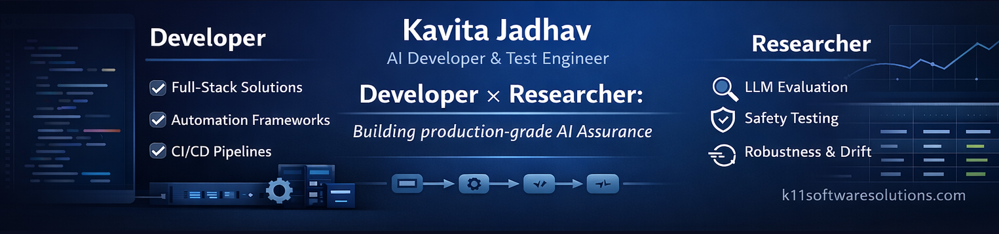

### AI Quality Engineer · Senior SDET · Researcher in AI assurance

I build tools that make AI systems **testable, measurable and auditable**, and I publish the research behind them. 
12+ years of test automation for VMware, E\*TRADE / Morgan Stanley, Verizon, Delta Dental and Wells Fargo.

---

## 🚀 Now shipping: MCP servers for QA teams

Give Claude (or any MCP client) testing tools that check their work against the real system and leave evidence a reviewer can follow. All six are free, MIT licensed and listed in the official [MCP Registry](https://registry.modelcontextprotocol.io).

| | What it does | Install |
|---|---|---|
| **[k11 Playwright QA](https://github.com/K11-Software-Solutions/k11techlab-playwright-qa-mcp)** | User stories to Playwright tests with verified locators. Self-healing with confidence, reasons and the runner-up; `heal-ci` opens a pull request with an audit report. |  |
| **[k11 Selenium QA](https://github.com/K11-Software-Solutions/k11techlab-selenium-qa-mcp)** | The same for Selenium in Python and Java, fixing Page Objects and `@FindBy` where they live, and reverting any fix that doesn't pass. |  |
| **[k11 API Contract QA](https://github.com/K11-Software-Solutions/k11techlab-api-contract-qa-mcp)** | Which services an API change breaks before merge, and why, for OpenAPI, Swagger, GraphQL, gRPC, AsyncAPI and SOAP; drift checks against deployed services; a verdict on every pull request. |  |
| **[k11 API Functional QA](https://github.com/K11-Software-Solutions/k11techlab-api-functional-qa-mcp)** | Functional API tests from user stories, with database checks and negative tests generated from the spec; guardrails keep it away from production data. |  |
| **[LLM Assure](https://github.com/K11-Software-Solutions/k11techlab-llm-assurance-toolkit)** | Red-teams chatbots, RAG apps and agents: 41 OWASP LLM Top 10 probes, adaptive attacks driven by Claude, a CI gate and an audit-ready report. |  |
| **[k11 Release Gate](https://github.com/K11-Software-Solutions/k11techlab-release-gate-mcp)** | One release decision from all the evidence above under a written policy: ship, ship with conditions, needs a named person, or block, with an audit trail. |  |

## 🧭 Learn AI quality engineering: 10 open labs

A free, runnable curriculum for testing AI the way we test software. Every lab runs locally with **no API key** and ends in CI quality gates.

**[Start with the roadmap →](https://github.com/K11-Software-Solutions/becoming-ai-quality-engineer)** · model testing · LLM-judge reliability · data quality · security · agents · multi-agent · MCP supply chain · performance and cost · production monitoring · **[assurance case capstone](https://github.com/K11-Software-Solutions/ai-assurance-case-lab)** (NIST AI RMF, ISO/IEC 42001, EU AI Act)

All labs: **[K11 Tech Lab on GitHub](https://github.com/K11-Software-Solutions)**

## 📄 Research: Agentic AI Quality Engineering (IJECS, 2026)

A six-paper, peer-reviewed series, with open-source reference code where it applies.

1. [Autonomous CI/CD Quality Assurance Using LangGraph Multi-Agent Orchestration and Risk-Proportionate Human-in-the-Loop Control](https://doi.org/10.18535/ijecs/v15i06.5563) · [code](https://github.com/K11-Software-Solutions/k11techlab-agentic-ai-qa-system)
2. [LLM Safety as a Quality Gate: Bias, Fairness and Robustness Evaluation in CI/CD via GitHub Apps](https://doi.org/10.18535/ijecs.v15i07.5576) · [code](https://github.com/K11-Software-Solutions/llm-eval-agent-app)
3. [Beyond Static Gates: Closing the Detect–Fix–Learn Loop in Agentic CI/CD Quality Assurance](https://doi.org/10.18535/ijecs.v15i07.5577)
4. [Cross-Repository Contract Testing and Change Impact Analysis in Microservice CI/CD](https://doi.org/10.18535/ijecs.v15i07.5599) · [code](https://github.com/K11-Software-Solutions/k11techlab-microservice-qa-system)
5. [Beyond Binary Verdicts: Aleatoric Uncertainty Quantification in Agentic CI/CD Quality Pipelines](https://doi.org/10.18535/ijecs.v15i07.5614)
6. [Beyond a Single Threshold: Uncertainty Source Classification and Type-Stratified Conformal Prediction for Agentic CI/CD](https://doi.org/10.18535/ijecs.v15i08.5684)

## 🧪 Test automation frameworks

Production-style starters with page objects, CI pipelines, reporting and AI-assisted test generation:
[Playwright + Python](https://github.com/K11-Software-Solutions/k11techlab-playwright-python-ai-assisted-framework) ·
[Playwright + TypeScript](https://github.com/K11-Software-Solutions/K11TechLab-playwright-typescript-ai-augmented-framework) ·
[Playwright + JavaScript](https://github.com/K11-Software-Solutions/K11TechLab-playwright-javascript-ai-augmented-framework) ·
[Selenium + Java](https://github.com/K11-Software-Solutions/k11TechLab-selenium-java-fullstack-framework) ·
[Cucumber BDD + Java](https://github.com/K11-Software-Solutions/k11TechLab-cucumber-bdd-java-fullstack-framework) ·
[Serenity Screenplay](https://github.com/K11-Software-Solutions/k11TechLab-serenity-screenplay-framework) ·
[Vibium + Jest](https://github.com/K11-Software-Solutions/k11TechLab-vibium-jest-ai-test-framework) ·
[Adaptive Test Intelligence](https://github.com/K11-Software-Solutions/adaptive-test-intelligence)

## 🛠️ Stack

<b>Full-stack portfolio projects</b>

- [AI developer portfolio (Gemini + Cloud Run)](https://github.com/kavitaj11/kavita-jadhav-ai-developer-portfolio): Gemini-backed chat behind a secure backend proxy, Dockerized and deployed on Cloud Run ([walkthrough](https://dev.to/kavitaj11/ai-powered-portfolio-full-stack-developer-showcase-with-google-gemini-cloud-run-2aaj))
- [AI assurance with Promptfoo](https://github.com/kavitaj11/weoptimize.ai_assurance_promptfoo): LLM evaluation, regression testing and red-teaming scenarios
- [LLM Testing Hub](https://github.com/K11-Software-Solutions/llm-testing-hub): prompt regression, red-teaming and risk audits with Promptfoo, LangTest and DeepEval
- [Full-stack developer capstone](https://github.com/kavitaj11/xrwvm-fullstack_developer_capstone)
- [Apollonia Dental: employee management CRUD app](https://github.com/kavitaj11/apollonia-dental-practice-employee-management-system-CRUD-web-app)
- [Greenspot Grocer: relational database redesign](https://github.com/kavitaj11/greenspot-grocery-portfolio-database-project)
- [Rumi Press: Django expense tracker](https://github.com/kavitaj11/django_based_rumi_press_book_distribution_expense_tracker)
- [Euro Orbit: 7-day weather forecast app](https://github.com/kavitaj11/euro-orbit-travel-agency-7-day-weather-forecast-app)

---

## 📬 Stay in the loop

- **[Trustworthy AI Engineering](https://www.linkedin.com/newsletters/trustworthy-ai-engineering-7521267953363832832/)**: practical AI assurance, every two weeks
- **[SDET Insights](https://www.linkedin.com/newsletters/sdet-insights-7354009267919613954/)**: test automation, weekly
- **Work with me:** adoption help for these tools, team workshops and custom MCP servers at **[k11softwaresolutions.com](https://k11softwaresolutions.com/contact)**

**If something here saved you time, follow me and star the repo. It helps other engineers find it.**

